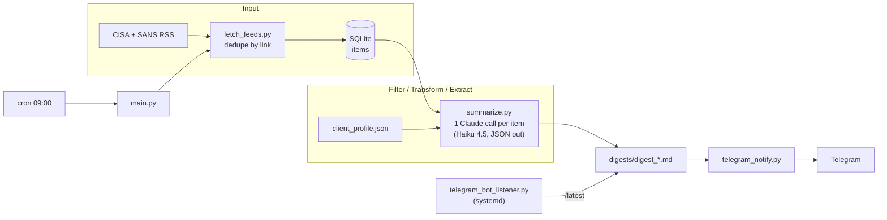

# Intel Digest: client-aware threat intel triage with Claude

An automated pipeline that reads public threat intel feeds, uses Claude to judge each item against a **client environment profile**, and delivers only the relevant ones to Telegram with a plain-language summary, extracted IOCs, and links to the technical reports.

> **Homelab project.** It runs against a **synthetic** client profile (an EV charging / critical infrastructure company). No real client or employer data is used anywhere in this repo.

## The problem

Threat intel volume grows faster than any team can read it. In many SOCs, review is informal: whoever read something interesting brings it up. That leaves gaps. Important advisories get missed, and discussion is driven by what people happened to see rather than what affects the environments they defend.

This project tests one idea: **start the conversation from intel already filtered against the environment.** The goal is better discussion, not replacing it.

## What it does

1. **Pulls** CISA Alerts and the SANS ISC Diary (RSS) and dedupes against a SQLite store.
2. **Judges** each new item with one Claude call: is this an active threat or vulnerability affecting something in the client profile?
3. **Extracts** for relevant items: a summary, why it matters to this environment, a suggested action, IOCs (IPs, domains, URLs, hashes, CVEs), and technical reference links found in the source.
4. **Delivers** a markdown digest to Telegram every morning. Sending `/latest` to the bot returns the newest digest on demand.

See [`docs/sample_digest.md`](docs/sample_digest.md) for the output format.

## Architecture



It is a **scripted pipeline with an LLM classifier/extractor**, not an autonomous agent. There is no tool use or planning loop. Fetching, deduping, formatting and delivery are deterministic Python, and the model makes one bounded judgment per item. That was a deliberate choice: it is cheaper, more predictable, and easier to test.

## Design decisions

**Strict relevance, with one deliberate exception.** Early runs flagged defensive how-to articles just because they named a vendor in the profile. The prompt now requires an *active* vulnerability, exploit, threat or incident. The exception is OT/ICS: advisories for industrial equipment from the same vendor family or sector are flagged even if the exact product isn't listed, because missing a real industrial-control threat costs more than a false positive, and a synthetic profile shouldn't hide them. The trade-off is written into the prompt so it is explicit rather than implicit.

**IOCs must be literal and non-benign.** The model may only extract indicators that appear in the source text, and the prompt excludes cloud metadata addresses (`169.254.169.254`) and documentation ranges (RFC 5737), which showed up as "IOCs" in early output but are technique context, not indicators.

**Automation drafts, humans approve.** Nothing is pushed into production detections. Output is for analyst review.

**Smallest model that does the job.** Claude Haiku 4.5, since this is high-volume, low-complexity triage. A normal day costs a few cents, and a full re-score of ~50 items is well under $1.

## Bugs found while validating (the interesting part)

| Issue | Symptom | Fix |
|---|---|---|
| Over-broad relevance | Tutorials flagged for naming a profile vendor | Require an active threat, not a name-drop |
| Benign IP as IOC | Cloud metadata address listed as an indicator | Explicit exclusion list |
| OT/ICS over-correction | A real ICS advisory with CVEs vanished after tightening | OT/ICS carve-out, inclusive for that category only |
| **Silent truncation** | `max_tokens=500` cut the JSON mid-response; the parser fell back to "not relevant" with a plausible-looking reason | Raised to 1000; parse failures now warn loudly and are labeled as *not a real judgment* |
| Same-day overwrite | A later empty run overwrote the morning's real digest | Timestamped filenames |
| Scheduling race | The 8 AM run sometimes beat CISA's batch publish time (`12:00 UTC`) | Moved to 9 AM |

**The lesson from the truncation bug:** it produced a false negative that *looked like a legitimate judgment*. It was found only by querying the stored analysis for an item that should have matched. When output doesn't match expectations, check the raw stored result before blaming the prompt. Silent fallbacks on LLM output are a trap.

## Validation

| Run | Items | Flagged relevant | Notes |
|---|---|---|---|
| First live run | 40 | 7 | 4 were defensive tutorials; benign IP listed as an IOC |
| After tightening | 40 | 3 | Over-corrected: an OT advisory was lost |
| After carve-out + token fix | 40 | 11 | 0 parse errors; ICS advisories, KEV updates and a ransomware advisory matching the profile's exposed VPN/RDP |
| Full re-score | 52 | 16 | Consistent with earlier runs |
| First unattended cron run | 1 new | 0 | Completed end to end |

Relevance is reviewed by hand after each run. There is no labeled ground-truth set yet, so these numbers describe behavior, not measured precision or recall.

## Security considerations

- **Prompt injection** is the main AI-specific risk. Feed text is untrusted and goes into the prompt. Current mitigations are strict JSON parsing, IOC rules, and human review of output. Planned hardening: wrap feed content in untrusted-data delimiters and add an adversarial test set.
- **Secrets** live in `.env` (`chmod 600`), never in code or git.
- **The Telegram listener** only answers the configured chat ID.
- **Static checks:** `bandit` and `pip-audit` were run at build time and re-checked periodically. There is no web endpoint, so DAST doesn't apply. Fuzzing malformed feeds is the equivalent.

## Limitations

- Synthetic profile only; no real asset inventory, so real-world relevance quality is untested.
- Two public feeds, one model call per item, no cross-item correlation.
- Relevance quality is judged by hand, not benchmarked.
- Single-tenant: one profile, one Telegram chat.
- Built on an always-on homelab box; there is no HA or retry queue beyond cron's next run.

## Roadmap

- Multi-client support: per-client profiles, relevance tracked per client-item pair, per-client digests (and `/<client>` commands).
- Better team delivery: Elasticsearch/Kibana dashboard as system of record, plus Discord channels or Telegram Topics per client.
- Wire in the already-built **ATT&CK technique mapping** (validates IDs against the MITRE STIX catalog) and **MISP push** (unpublished events for review) once daily output is trusted.
- Pre-filter content-free items before they reach the model.
- Prompt-injection hardening and an adversarial test suite; a labeled evaluation set.

## Tech stack

Python 3.11+ · Anthropic Messages API (Claude Haiku 4.5) · feedparser · SQLite · Telegram Bot API · cron + systemd · (optional) MITRE ATT&CK STIX, PyMISP

## Quick start

```bash
git clone <this repo> && cd intel-digest
python3 -m venv venv && source venv/bin/activate
pip install -r requirements.txt
cp .env.example .env && chmod 600 .env     # add your keys
python3 main.py                             # first run; digest lands in digests/
```

Scheduling, the Telegram listener service, archiving and troubleshooting are in [`docs/RUNBOOK.md`](docs/RUNBOOK.md).

## Repo layout

```
main.py                     orchestrates fetch → analyze → write → send
fetch_feeds.py, feeds.py    input + dedupe
summarize.py                prompt, Claude call, parsing
client_profile.json         synthetic client environment
telegram_notify.py          push delivery
telegram_bot_listener.py    /latest on demand
archive_digests.py          monthly cleanup of old digests
attack_mapper.py, build_attack_library.py, push_to_misp.py
                            built and tested, not deployed (see roadmap)
deploy/                     cron wrappers and systemd unit (placeholders)
docs/                       runbook and sample digest
```

`attack_techniques.json` is generated by `build_attack_library.py` and is not committed.
